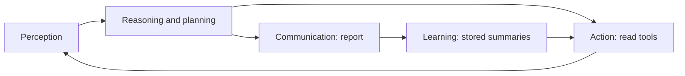

# Five subsystems in ops-assist

An investigation starts with observations and ends with a validated report. The pre-triage is deterministic; the agent remains responsible for investigating the evidence.

## Perception

The observation interface and replay source live in `src/ops_assist/observability/base.py` and `src/ops_assist/observability/replay.py`. ADK invokes tools that obtain observations; it does not supply this incident source. Prometheus supplies alerts and metrics, Loki supplies logs, and the composite source uses an explicitly configured changes file; without it, changes are unavailable. Streaming alerts remain future work.

## Reasoning and planning

The deterministic pre-triage in `src/ops_assist/triage.py` selects candidates, while `src/ops_assist/agent.py`, `src/ops_assist/models.py` and `src/ops_assist/prompts/investigator.md` configure the model and instruction. ADK runs the model and its tool loop; planning is implicit in model choices, not a guaranteed plan. Explicit planning and evaluation are future work.

## Action

Read-only tools in `src/ops_assist/tools.py` retrieve evidence and bounded summaries. ADK exposes their schemas and dispatches calls. Remediation execution and approval flows are absent.

## Learning

`src/ops_assist/memory.py` stores validated report summaries and supports recall; `src/ops_assist/run.py` uses ADK in-memory sessions by default or SQLite sessions when `OPS_ASSIST_SESSION_DB` is set. SQLite persists session events and state and permits resuming a session by ID; it is separate from long-term summaries. ADK provides both session services. This is retrieval, not model learning: feedback, evaluation and adaptation remain future work.

## Communication

`src/ops_assist/report.py` defines the report; `src/ops_assist/cli.py` prints it and the trace. ADK validates the output schema and stores the output in session state. Agent-to-agent communication and richer interfaces remain future work.

## Tool calls and live sources

`OPS_ASSIST_SOURCE` selects replay by default or a composite of Prometheus, Loki and an optional explicit changes file. Both live connectors reject changes directly. Prometheus requests the last hour and requires a single series; Loki uses indexed `service` and `level` labels, filters level server-side, and checks service label values to distinguish a silent service from an unknown one. The HTTP timeout defaults to five seconds. The async tools run synchronous source operations in a dedicated pool of four daemon workers and four queued tasks with a ten-second default timeout; a timed-out thread is abandoned and does not delay process exit. Hand-made HTTP fixtures in the API formats exercise the same declared-capability contract without network access; they are not server captures and do not exercise the time window.
