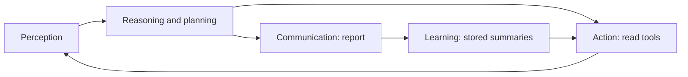

# Five subsystems in ops-assist

An investigation starts with observations and ends with a validated report. The pre-triage is deterministic; the agent remains responsible for investigating the evidence.

## Perception

The observation interface and replay source live in `src/ops_assist/observability/base.py` and `src/ops_assist/observability/replay.py`. ADK invokes tools that obtain observations; it does not supply this incident source. Prometheus supplies alerts and metrics, Loki supplies logs, and the composite source uses an explicitly configured changes file; without it, changes are unavailable. Streaming alerts remain future work.

## Reasoning and planning

The deterministic pre-triage in `src/ops_assist/triage.py` selects candidates, while `src/ops_assist/agent.py`, `src/ops_assist/models.py` and `src/ops_assist/prompts/investigator.md` configure the model and instruction. ADK runs the model and its tool loop; planning is implicit in model choices, not a guaranteed plan. Explicit planning is future work; incident evaluation is described below.

## Action

Read-only tools in `src/ops_assist/tools.py` retrieve evidence and bounded summaries. ADK exposes their schemas and dispatches calls. An explicitly enabled rollback requires ADK human confirmation, changes replay state only, and refuses live connectors.

## Learning

`src/ops_assist/memory.py` stores validated report summaries and supports recall; `src/ops_assist/run.py` uses ADK in-memory sessions by default or SQLite sessions when `OPS_ASSIST_SESSION_DB` is set. SQLite persists session events and state and permits resuming a session by ID; it is separate from long-term summaries. ADK provides both session services. This is retrieval, not model learning: automated feedback and adaptation remain future work.

## Communication

`src/ops_assist/report.py` defines the report; `src/ops_assist/cli.py` prints it and the trace. ADK validates the output schema and stores the output in session state. A2A adds agent-to-agent communication; richer interfaces remain future work.

## Tool calls and live sources

`OPS_ASSIST_SOURCE` selects replay by default or a composite of Prometheus, Loki and an optional explicit changes file. Both live connectors reject changes directly. Prometheus requests the last hour and requires a single series; Loki uses indexed `service` and `level` labels, filters level server-side, and checks service label values to distinguish a silent service from an unknown one. The HTTP timeout defaults to five seconds. The async tools run synchronous source operations in a dedicated pool of four daemon workers and four queued tasks with a ten-second default timeout; a timed-out thread is abandoned and does not delay process exit. Hand-made HTTP fixtures in the API formats exercise the same declared-capability contract without network access; they are not server captures and do not exercise the time window.

## MCP over stdio

`OPS_ASSIST_TOOLS=mcp` replaces the four in-process observation functions with an ADK `McpToolset` connected to a local child process. The official MCP SDK server registers the same functions and source configuration; the selected incident is passed to the child. Discovery and calls use stdio, and the runner closes the toolset after an investigation. Memory recall and deterministic pre-triage remain in the agent process. Arbitrary injected Python sources cannot be transferred and are rejected in MCP mode. The default `inprocess` mode and model profiles are unchanged. MCP SDK 2 names the former `FastMCP` server class `MCPServer`.

## Investigation skills

At agent construction, ADK loads and validates the packaged `latency` and `errors-5xx` SKILL.md files. The agent registers them with `SkillToolset` in both direct and MCP modes. ADK exposes discovery through `list_skills` and returns the selected instructions through `load_skill`; using these instructions remains a model decision. Skills describe investigation methods and do not provide observation data or replace the read-only tools. Invalid files fail startup with their path.

## A2A delegation

`src/ops_assist/a2a_server.py` publishes the configured investigator through ADK `to_a2a` and an explicit card advertising the `investigate` skill. The CLI binds the server to loopback. `apps/oncall_assistant` uses a custom ADK agent containing `RemoteA2aAgent` to forward the question and validate the returned `IncidentReport` before presenting it. The remote investigator retains its configured model profile, source and tool mode. A2A delegates an investigation; MCP exposes individual observation tools and can be used inside that investigation. ADK keeps tasks and sessions in memory by default; an optional `OPS_ASSIST_A2A_TOKEN` enforces bearer authentication on A2A calls while leaving the card public. `OPS_ASSIST_A2A_TIMEOUT` bounds delegation to 120 seconds by default. For remote access, deploy a TLS reverse proxy in front of the loopback listener and rewrite the loopback URL advertised in the card. The offline test uses ASGI transport and a scripted model to exercise the card, remote request and sourced response without a network or real model.

## Étape 12 : rôles et frontières

La topologie `single` reste le défaut pour préserver les scénarios existants. Avec `OPS_ASSIST_TOPOLOGY=experts`, le coordinateur conserve le pré-triage, le rappel mémoire, les skills et le rapport final ; deux sous-agents `single_turn` déclarés dans `sub_agents` et exposés comme outils par ADK collectent les preuves : `metrics_expert` possède `get_metric` et `get_alerts`, et `logs_expert` possède `get_logs` et `get_changes`. Les experts ne se voient pas et ne transfèrent pas le contrôle. En mode MCP, deux filtres distincts limitent les outils découverts par chaque expert. Tous utilisent le profil et la chaîne de repli configurés. Les résultats restent des données non fiables ; le coordinateur valide le rapport structuré. Cette délégation ajoute des appels de modèle et peut perdre des détails dans les synthèses. Les anciennes versions utilisaient directement `AgentTool` pour envelopper un agent. ADK 2.14.1 déconseille cet usage direct : il crée un runner et une session imbriqués, tandis que `single_turn` exécute le sous-agent dans la session du parent et rend ses événements visibles dans cette session.

## Security boundary

`src/ops_assist/security.py` attaches the same before, after and error callbacks to the coordinator and experts. Its explicit tool table defaults unknown tools to write; read-only is the default. `OPS_ASSIST_ALLOW_WRITES=1` exposes a confirmation-gated `FunctionTool` for rollback. ADK interrupts the call and the CLI relays the human response. The replay action verifies the deployment and writes an atomic simulated state file outside the recorded incident; live always refuses, while demo requires an injected client and has no offline implementation. Per-invocation budgets count tool calls and expert delegations across agents; ADK reuses the invocation ID when confirmation resumes, so the same counter applies. Counters are in memory, not a persistent quota. Audit JSONL records outcomes, durations and heuristically redacted arguments, including refusals. A confirmed write requires a flushed and synchronized pending entry before execution; later audit writes can still fail. The audit and state files use plain names inside one directory opened through a validated directory descriptor, which anchors all file operations. The root must be owned by the current user, not group or world writable, not overlap the package and contain no symlink components. Files must be owned regular files without symlinks or hard links; audit permissions are enforced as 0600. The A2A and MCP servers never expose a write. An agent consuming MCP tools may still offer confirmed rollback through a human channel such as the CLI or ADK web UI. The direct MCP server exposes only read tools and does not use the agent callbacks for independent clients. Pre-triage is deterministic source access, not an ADK tool call. The offline security tests exercise the trapped log, confirmation, three source modes and budget decisions.

## AI gateway

The `gateway` profile sends an OpenAI-compatible request to the local LiteLLM proxy. `deploy/litellm/config.yaml` routes a Gemini alias to an OpenAI fallback and disables message logging in LiteLLM callbacks. A PostgreSQL-backed virtual key, created separately with the documented budget and rate limits, controls client access and enables spend records. Provider keys remain in the proxy environment. ADK fallback is independent: its client-side transitions log both model names before the next attempt. The CLI reports model versions supplied by responses; a proxy may return only an alias, so its internal fallback cannot be inferred reliably from the CLI alone. Provider and infrastructure logs require their own confidentiality controls. The offline tests exercise ADK fallback with fake clients, not the proxy.

## Knowledge search

The CLI builds a flat local JSON index from sections of the packaged fictional Markdown corpus. Hashing gives a deterministic offline baseline; a configurable LiteLLM embedding model can instead produce normalized vectors. The index is stored atomically within the validated state root; `OPS_ASSIST_INDEX_FILE` is a plain file name. It records the embedding identity and dimension and refuses incompatible queries. Vector search ranks cosine similarity across all sections; the configurable default also combines lexical rankings as described below. Retrieved text is untrusted data and similarity is not evidence of relevance. The coordinator also has the read-only `search_knowledge` tool; MCP does not expose it. Rebuild the index whenever its corpus or embedding model changes.

## Recherche documentaire et citations

Le pipeline charge les documents fictifs, découpe leurs sections, calcule les embeddings puis construit un index cosinus local. Un manifeste enregistre l’identifiant, le checksum et le nombre de sections de chaque document ; seuls les documents modifiés sont réencodés dans le même espace vectoriel. Le changement de modèle reconstruit l’index. Le coordinateur seul dispose de `search_knowledge`, classé en lecture et limité à huit extraits de 800 caractères ; MCP ne l’expose pas. Les résultats restent des données non fiables. Après génération, `investigate` contrôle les identifiants de chunks cités contre l’index et inscrit les avertissements dans le rapport et la trace. Ce contrôle ne démontre ni la fraîcheur ni la fidélité des affirmations ; les procédures restent des conseils et ne constituent pas des observations de l’incident.

## Retrieval variants

The lexical BM25 index is built in memory from the same persisted chunks as the vector index. `OPS_ASSIST_RETRIEVAL` selects vector, BM25 or hybrid rankings; hybrid uses reciprocal rank fusion with constant 60. Optional keyword overlap or a configurable LiteLLM model reranks up to 20 candidates by default, preserving retrieval scores in output. The model scores each untrusted excerpt separately and must return a single digit from 0 to 3. On an invalid score or provider error, search retains the original ranking, logs a warning and reports a sanitized reranking failure in the tool result. `knowledge eval` builds a separate hash index in memory and measures mean recall@5 and MRR@5 against ten packaged fictional questions; it does not access a provider or alter the persisted index. These metrics describe the labeled set, not production quality.

## Dependency graph and GraphRAG-lite

The packaged fictional graph represents directed calls, dependencies and ownership with dated edges. `get_dependencies` traverses up to three hops in either direction, returns provenance and marks edges older than `OPS_ASSIST_GRAPH_MAX_AGE_DAYS` (90 by default). Pretriage adds bounded hints when a directly dependent service is also alerting; these are leads, not diagnoses. Optional `search_knowledge(expand=true)` matches service names in the query and adds bounded corpus excerpts for direct technical dependencies, with the edges that led to them. This local expansion is not community-based GraphRAG. Graph data and excerpts are untrusted; stale flags do not prove correctness. Both tools remain coordinator-only reads, including when observations use MCP.

## Agentic retrieval

The coordinator decides whether knowledge search helps, reformulates weak searches at most twice by instruction, and records an unknown when it stops. The security boundary enforces `OPS_ASSIST_MAX_SEARCHES` (three attempts per invocation by default), independently of the general tool budget; a refusal returns `knowledge_search_limit`. The trace associates each query with its tool response by call ID, including failures and refusals; an unmatched response leaves the outcome unknown. Tool arguments are redacted and bounded, and the trace retains at most 50 calls plus an omitted count. Counters are in memory and do not survive a process restart.

Quality is a heuristic computed on the returned primary chunks before graph expansion: the maximum fraction of distinct query tokens present in the first 800 characters of any returned chunk. No chunks gives `none`; an overlap of at least 0.5 gives `good`; otherwise it is `weak` with a reformulation suggestion. This normalized lexical score is independent of the incompatible vector, BM25 and RRF score scales and remains only a signal, not proof of relevance.

## Living knowledge

The CLI saves each validated investigation report by session and as the latest report in the local state directory. Draft generation validates that report, records a SHA-256 hash of its canonical JSON and session provenance, and applies the memory redactor before writing Markdown. Reports themselves may contain unredacted data and require protection.

Drafts are excluded from retrieval. Approval records the supplied reviewer, UTC time and interactive or explicitly opted-in noninteractive mode, moves the document to the approved local corpus and incrementally rebuilds the existing index. Changed draft bodies require explicit acceptance; the approved body is redacted again and marked as untrusted. Failed indexing leaves the draft available. Search results carry the document date and a stale flag and reason calculated at query time against UTC; `OPS_ASSIST_KNOWLEDGE_MAX_AGE_DAYS` controls the threshold. These results remain untrusted data, and freshness does not establish correctness.

## Incident evaluation data

The versioned offline manifest in `data/eval/` lists six fictional replay cases and their questions. Its checksum covers each question and all six recording files, including the answer key; published version checksums are checked against the packaged `data/eval/published.yaml` registry at load time and historical entries are pinned in tests. The datasheet records provenance, intended use and limitations. Replay reads only the five observation files, rejecting symbolic links and answer keys; token counting uses the same allowlist. Evaluation answers are kept outside the knowledge corpus, prompts, skills and examples, with an exact-text regression guard. This guard cannot detect paraphrases, and the public dataset is not a secret benchmark. Four cases accept causal links as hypotheses without requiring an unproven conclusion; the answer keys define accepted statuses and hypotheses for the scoring engine below. Evaluation introduces no new agent tool.

The offline `tokens --all` command enumerates the configured replay directory and counts only observation files with LiteLLM’s bundled tokenizer. Each incident is compared separately with the selected model’s `max_input_tokens` metadata when available; the estimate excludes instructions, tool schemas, history and output and may differ from the server’s actual limit.

## Incident evaluation

`ops-assist eval run` loads the validated versioned dataset, runs each question with its bundled replay source and a fresh in-memory session, and scores the report against the separate answer key. Status, report validity and required fact source categories are checked. For a known root cause, the highest-confidence hypothesis must contain both expected identifiers in one affirmative sentence. For `hypotheses_only`, at least one hypothesis must contain the service and change from an accepted entry in one affirmative sentence. For `insufficient_data`, unknowns must be nonempty and no hypothesis may have confidence above 0.5. A status mismatch always fails.

Sentence-level English negation markers include `not`, `no`, `ruled out`, `excluded`, `unlikely`, `rather than` and `instead of`. A marker anywhere in a sentence makes that sentence non-affirmative; this conservative heuristic does not understand scope, double negation, synonyms or causal meaning. Forbidden conclusions are checked in summary and hypotheses, sentence by sentence, with case folding and a small set of simple inflections; paraphrases and intervening words can evade the check. Neither cited sources nor identifier mentions prove the evidence or causal link. Review reports as well as scores.

Failures and investigation errors remain in the denominator. Evaluation disables tool writes and does not append investigation summaries, but existing memory and retrieval configuration can affect a run; keep them fixed for comparisons. The private result file in the confined state directory contains the dataset checksum, profile, model IDs, per-case checks, validated reports and bounded errors. Reports and errors receive heuristic secret redaction, which cannot guarantee removal of all sensitive content. `--show-reports` prints those same redacted reports and errors. See [decision 0002](decisions/0002-no-fine-tuning.md) and [workshop 23](../ateliers/23-changer-un-modele/README.md).
