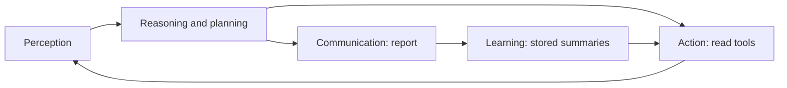

# Five subsystems in ops-assist

An investigation starts with observations and ends with a validated report. The pre-triage is deterministic; the agent remains responsible for investigating the evidence.

## Perception

The observation interface and replay source live in `src/ops_assist/observability/base.py` and `src/ops_assist/observability/replay.py`. ADK invokes tools that obtain observations; it does not supply this incident source. Prometheus supplies alerts and metrics, Loki supplies logs, and the composite source uses an explicitly configured changes file; without it, changes are unavailable. Streaming alerts remain future work.

## Reasoning and planning

The deterministic pre-triage in `src/ops_assist/triage.py` selects candidates, while `src/ops_assist/agent.py`, `src/ops_assist/models.py` and `src/ops_assist/prompts/investigator.md` configure the model and instruction. ADK runs the model and its tool loop; planning is implicit in model choices, not a guaranteed plan. Explicit planning and evaluation are future work.

## Action

Read-only tools in `src/ops_assist/tools.py` retrieve evidence and bounded summaries. ADK exposes their schemas and dispatches calls. An explicitly enabled rollback requires ADK human confirmation, changes replay state only, and refuses live connectors.

## Learning

`src/ops_assist/memory.py` stores validated report summaries and supports recall; `src/ops_assist/run.py` uses ADK in-memory sessions by default or SQLite sessions when `OPS_ASSIST_SESSION_DB` is set. SQLite persists session events and state and permits resuming a session by ID; it is separate from long-term summaries. ADK provides both session services. This is retrieval, not model learning: feedback, evaluation and adaptation remain future work.

## Communication

`src/ops_assist/report.py` defines the report; `src/ops_assist/cli.py` prints it and the trace. ADK validates the output schema and stores the output in session state. A2A adds agent-to-agent communication; richer interfaces remain future work.

## Tool calls and live sources

`OPS_ASSIST_SOURCE` selects replay by default or a composite of Prometheus, Loki and an optional explicit changes file. Both live connectors reject changes directly. Prometheus requests the last hour and requires a single series; Loki uses indexed `service` and `level` labels, filters level server-side, and checks service label values to distinguish a silent service from an unknown one. The HTTP timeout defaults to five seconds. The async tools run synchronous source operations in a dedicated pool of four daemon workers and four queued tasks with a ten-second default timeout; a timed-out thread is abandoned and does not delay process exit. Hand-made HTTP fixtures in the API formats exercise the same declared-capability contract without network access; they are not server captures and do not exercise the time window.

## MCP over stdio

`OPS_ASSIST_TOOLS=mcp` replaces the four in-process observation functions with an ADK `McpToolset` connected to a local child process. The official MCP SDK server registers the same functions and source configuration; the selected incident is passed to the child. Discovery and calls use stdio, and the runner closes the toolset after an investigation. Memory recall and deterministic pre-triage remain in the agent process. Arbitrary injected Python sources cannot be transferred and are rejected in MCP mode. The default `inprocess` mode and model profiles are unchanged. MCP SDK 2 names the former `FastMCP` server class `MCPServer`.

## Investigation skills

At agent construction, ADK loads and validates the packaged `latency` and `errors-5xx` SKILL.md files. The agent registers them with `SkillToolset` in both direct and MCP modes. ADK exposes discovery through `list_skills` and returns the selected instructions through `load_skill`; using these instructions remains a model decision. Skills describe investigation methods and do not provide observation data or replace the read-only tools. Invalid files fail startup with their path.

## A2A delegation

`src/ops_assist/a2a_server.py` publishes the configured investigator through ADK `to_a2a` and an explicit card advertising the `investigate` skill. The CLI binds the server to loopback. `apps/oncall_assistant` uses a custom ADK agent containing `RemoteA2aAgent` to forward the question and validate the returned `IncidentReport` before presenting it. The remote investigator retains its configured model profile, source and tool mode. A2A delegates an investigation; MCP exposes individual observation tools and can be used inside that investigation. ADK keeps tasks and sessions in memory by default; an optional `OPS_ASSIST_A2A_TOKEN` enforces bearer authentication on A2A calls while leaving the card public. `OPS_ASSIST_A2A_TIMEOUT` bounds delegation to 120 seconds by default. For remote access, deploy a TLS reverse proxy in front of the loopback listener and rewrite the loopback URL advertised in the card. The offline test uses ASGI transport and a scripted model to exercise the card, remote request and sourced response without a network or real model.

## Étape 12 : rôles et frontières

La topologie `single` reste le défaut pour préserver les scénarios existants. Avec `OPS_ASSIST_TOPOLOGY=experts`, le coordinateur conserve le pré-triage, le rappel mémoire, les skills et le rapport final ; deux sous-agents `single_turn` déclarés dans `sub_agents` et exposés comme outils par ADK collectent les preuves : `metrics_expert` possède `get_metric` et `get_alerts`, et `logs_expert` possède `get_logs` et `get_changes`. Les experts ne se voient pas et ne transfèrent pas le contrôle. En mode MCP, deux filtres distincts limitent les outils découverts par chaque expert. Tous utilisent le profil et la chaîne de repli configurés. Les résultats restent des données non fiables ; le coordinateur valide le rapport structuré. Cette délégation ajoute des appels de modèle et peut perdre des détails dans les synthèses. Les anciennes versions utilisaient directement `AgentTool` pour envelopper un agent. ADK 2.14.1 déconseille cet usage direct : il crée un runner et une session imbriqués, tandis que `single_turn` exécute le sous-agent dans la session du parent et rend ses événements visibles dans cette session.

## Security boundary

`src/ops_assist/security.py` attaches the same before, after and error callbacks to the coordinator and experts. Its explicit tool table defaults unknown tools to write; read-only is the default. `OPS_ASSIST_ALLOW_WRITES=1` exposes a confirmation-gated `FunctionTool` for rollback. ADK interrupts the call and the CLI relays the human response. The replay action verifies the deployment and writes an atomic simulated state file outside the recorded incident; live always refuses, while demo requires an injected client and has no offline implementation. Per-invocation budgets count tool calls and expert delegations across agents; ADK reuses the invocation ID when confirmation resumes, so the same counter applies. Counters are in memory, not a persistent quota. Audit JSONL records outcomes, durations and heuristically redacted arguments, including refusals. A confirmed write requires a flushed and synchronized pending entry before execution; later audit writes can still fail. The audit and state files use plain names inside one directory opened through a validated directory descriptor, which anchors all file operations. The root must be owned by the current user, not group or world writable, not overlap the package and contain no symlink components. Files must be owned regular files without symlinks or hard links; audit permissions are enforced as 0600. The A2A and MCP servers never expose a write. An agent consuming MCP tools may still offer confirmed rollback through a human channel such as the CLI or ADK web UI. The direct MCP server exposes only read tools and does not use the agent callbacks for independent clients. Pre-triage is deterministic source access, not an ADK tool call. The offline security tests exercise the trapped log, confirmation, three source modes and budget decisions.

## AI gateway

The `gateway` profile sends an OpenAI-compatible request to the local LiteLLM proxy. `deploy/litellm/config.yaml` routes a Gemini alias to an OpenAI fallback and disables message logging in LiteLLM callbacks. A PostgreSQL-backed virtual key, created separately with the documented budget and rate limits, controls client access and enables spend records. Provider keys remain in the proxy environment. ADK fallback is independent: its client-side transitions log both model names before the next attempt. The CLI reports model versions supplied by responses; a proxy may return only an alias, so its internal fallback cannot be inferred reliably from the CLI alone. Provider and infrastructure logs require their own confidentiality controls. The offline tests exercise ADK fallback with fake clients, not the proxy.
