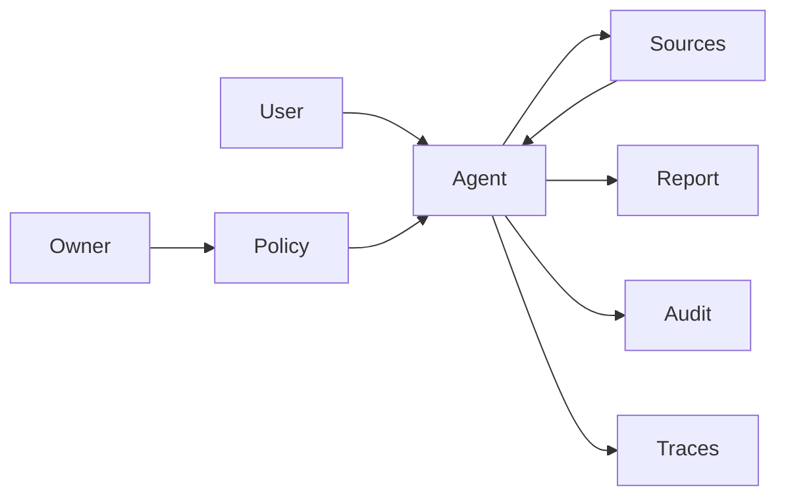

# Production readiness review

This review maps repository evidence to four operational questions. It describes an experimental incident assistant using fictional data; passing the checks is not proof of production readiness. A deployment owner must verify the actual configuration and infrastructure.

## What can it do and to what?

The [agent construction](../src/ops_assist/agent.py#L1) connects an investigator to observation and knowledge tools. [Replay and live sources](../src/ops_assist/observability/) provide incident data, and the [report schema](../src/ops_assist/report.py#L1) separates facts, hypotheses and unknowns. The [tool implementation](../src/ops_assist/tools.py#L1) bounds results, and the [prompt](../src/ops_assist/prompts/investigator.md) treats tool output as untrusted. The [policy](../src/ops_assist/security.py#L20) classifies tools; unknown tools default to write. Writes are disabled by default, and rollback requires enablement and human confirmation. [Security tests](../tests/test_security.py) exercise the boundary. Replay rollback changes simulated state; the live connector refuses it. These controls do not establish permissions or isolation for an actual deployment.

## How do we know it works?

[Scripted agent tests](../tests/test_agent_loop.py) exercise the investigation without a real model. The [evaluation dataset](../src/ops_assist/data/eval/dataset.yaml), [scorer](../src/ops_assist/evaluation.py#L1) and [threshold](../src/ops_assist/evals/threshold.yaml) provide repeatable checks; [evaluation tests](../tests/test_evaluation.py) cover scoring and gates. The [red-team probes](../src/ops_assist/redteam.py#L1) test selected boundaries, and [CI](../.github/workflows/ci.yml) runs offline checks before image construction. Fixtures and lexical scoring do not establish accuracy on real incidents, model changes or unseen attacks.

## How do we see what it did?

The [security audit](../src/ops_assist/security.py#L385) records tool outcomes and redacted arguments, with a durable pending record before confirmed writes. [Investigation traces](../src/ops_assist/run.py#L43) retain bounded model usage when available. Optional [tracing](../src/ops_assist/tracing.py#L1) exports selected metadata, not full investigation content; [tracing tests](../tests/test_tracing.py) exercise it. Redaction is heuristic, model usage may be missing, and a configured collector receives exported data. These records need protected storage, retention and operational monitoring.

## How do we stop or roll it back?

Stop the running process or disable access at the deployment boundary; this repository does not provide a centralized emergency stop. The [policy](../src/ops_assist/security.py#L368) defaults to no writes, limits tool calls and requires confirmation for writes; [tests](../tests/test_security.py) cover denial and audit failure. Disable write enablement and revoke credentials as appropriate. To roll back the assistant itself, redeploy a previously verified image or revision and restore compatible state using a deployment-specific procedure: [CI](../.github/workflows/ci.yml) builds images, but no automated deployment or rollback procedure is supplied. This is distinct from the agent's simulated deployment rollback tool.

## Missing before real production

- A named owner, on-call process, access controls, threat model and independent security review for the deployment.
- Representative data, acceptance targets, real-model evaluation and regression monitoring under an approved budget.
- Centralized emergency stop, tested incident response, deployment rollback and state recovery procedures.
- Enforced cost limits, operational alerts, protected audit and trace retention, privacy review and credential lifecycle.
- Validation of live source permissions, freshness, reliability and all external integrations in the target environment.

## Recommendations and roadmap

- Before deployment, assign an owner and close access, security, emergency-stop and recovery gaps.
- Before deployment, evaluate representative incidents and test rollback and recovery in the target environment.
- Before rollout, configure monitoring, retention and enforceable cost controls; rehearse the incident process.
- After rollout, review evaluations, access and costs regularly and after each material change.
